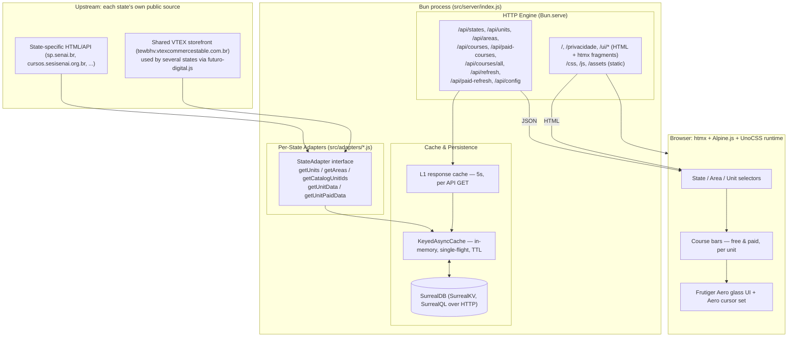

# SENAI Course Intelligence

An open-source real-time course discovery and monitoring platform covering multiple SENAI state federations across Brazil (SENAI-SP, SENAI-SC, and 17 others live, with more states tracked as "coming soon").

The platform continuously aggregates, normalizes, caches, and presents public course and class offerings for every monitored SENAI state through a single, searchable, responsive web interface — no navigating a different portal per state.

[](https://spsenai.arielaram.com)
[](https://github.com/ariel-aram/senai-cursos)
[](LICENSE)
[](https://bun.sh)
[](https://htmx.org)
[](https://alpinejs.dev)
[](https://surrealdb.com)

---

## Quick Links

- **Live Application:** [spsenai.arielaram.com](https://spsenai.arielaram.com)
- **Source Repository:** [github.com/ariel-aram/senai-cursos](https://github.com/ariel-aram/senai-cursos)
- **Contribution Guide:** [CONTRIBUTING.md](CONTRIBUTING.md)

---

## Why This Exists

### Problem

Every Brazilian state runs its own SENAI federation, each publishing course and vacancy data on its own domain, in its own format — some as a normal HTML site, some as a VTEX storefront, some behind a JS-heavy SPA. There is no single place to see "what's open, right now, near me" across states.

### Solution

SENAI Course Intelligence pulls from each state's real, live public data source through a small per-state **adapter** (see [Architecture](#architecture)), normalizes it into one shared schema, caches it, and serves a fast, filterable UI. Every course card links straight back to the state's own official enrollment page — this project never handles enrollment itself.

### Institutional Clarity

This is an independent, community-run project and is **not affiliated with, endorsed by, or representing SENAI, SESI, FIESP, or CNI** at the national or any state level. It does not process enrollments or manage student records. All data is sourced from each state's own public pages/APIs and may lag or drift from the source at any time — always confirm on the official site before enrolling.

---

## Key Features

- **Multi-State Coverage:** One selector across every monitored state (see `STATE_ORDER` in [`src/shared/state-meta.js`](src/shared/state-meta.js)); each active state has a real, verified adapter — a state is only flipped from "coming soon" to "active" once its data source has been inspected and confirmed to return real, current offerings.
- **Per-State Adapters, One Shared Schema:** Each state's adapter (`src/adapters/<uf>.js`) knows how to reach that state's real backend — some are direct HTML/API scrapers (SP, SC), some share a common VTEX storefront backend via `createFuturoDigitalAdapter()` (`src/adapters/futuro-digital.js`) — and all of them normalize into the same `Course`/`UnitInfo`/`Area` shape (JSDoc typedefs in `src/shared/types.js`).
- **Free vs. Paid Segregation:** Every state's catalog is split into free (bolsa) and paid offerings, each with its own vacancy count, class count, start dates, schedules, and price where available.
- **Area/Category Filtering:** Not just "Tecnologia da Informação" — every área a state's real catalog actually exposes is discoverable per state (`GET /api/areas`), with T.I. only kept as the first-paint default.
- **Resilient Caching:** In-memory single-flight caching (per state, per área) backed by an embedded SurrealDB (SurrealKV engine, queried with SurrealQL) for durability across restarts, plus a 5-second L1 response cache in front of the `/api/*` and `/ui/*` GETs to absorb request bursts.
- **Background Warmup + Proactive Refresh:** Every active state's default área is pre-warmed on server boot, then re-fetched proactively before its cache TTL expires — users hit a warm cache almost all the time, not a cold scrape.
- **Real-Time Client Updates:** Auto-refresh countdown (default 5 min) plus a manual refresh button, both scoped to the currently selected state/área/unit.
- **Frutiger Aero UI:** A glassmorphism interface (translucent glass cards, specular highlights, glow) themed per state via a single `--brand-hue` CSS variable, with an actual custom cursor set — real `.cur`/`.ani` files from a Windows Aero cursor pack, decoded and rendered as native browser cursors (see [`public/js/cursors.js`](public/js/cursors.js)), colored per state and swapped for context (default pointer, "busy" ring on hoverable states, "not allowed" on coming-soon states, "working" while data loads).
- **Deep Links to Official Portals:** Every course card links straight to that state's own official course page.
- **Server-Rendered, No Build Step:** Pages and htmx fragments are rendered by one native Bun HTTP process (`src/server/`). There is no `package.json`, no `node_modules` and no bundler: the browser loads htmx, Alpine.js and the UnoCSS runtime from CDNs, and Bun runs the plain-JS sources directly.

---

## Architecture



### Layer Roles

- **Adapters (`src/adapters/*.js`):** One file per active state, each implementing the shared `StateAdapter` interface (`StateAdapter` in `src/shared/types.js`). Several states (currently MA, MS, GO, TO, PI, RO, CE, MT, PR, ES, PA, PE, RN) share a single implementation, `createFuturoDigitalAdapter(uf, refPrefix)`, since they all sell through the same VTEX storefront backend and are only distinguished by a `"UF|"` prefix on `productReferenceCode`. SP and SC have their own dedicated scrapers. The registry (`src/adapters/registry.js`) maps `uf -> adapter` and is the actual source of truth for "active" vs. "coming soon" (`src/shared/state-meta.js`'s `KNOWN_ACTIVE` is only a first-paint hint and is checked against the registry at startup in development).
- **Cache & Persistence (`src/adapters/keyed-cache.js`, `src/db/`):** `KeyedAsyncCache` coalesces concurrent identical requests into one upstream call and treats an empty result as a likely transient failure (not "genuinely zero courses"), so it won't cache a bad zero over real data. SurrealDB runs as a child `surreal` process with the SurrealKV engine; the server talks SurrealQL to it over HTTP (`src/db/surreal.js`), with the schema and stored queries (`fn::*`) in `src/db/schema.surql`. It persists the last known-good `Course`/`UnitInfo` rows per state so a cold start still has data to show while the cache re-warms.
- **HTTP Engine (`src/server/`):** One `Bun.serve()` call serves the pages (`routes/pages.js`), the htmx fragments (`routes/ui.js`), the JSON API (`routes/api.js`) and static files from `public/`, with a 5-second L1 cache in front of GETs (`l1.js`) and a scheduled proactive refresh loop (`startup.js`) that re-warms every active state before its TTL actually expires.
- **Views (`src/views/`) and client (`public/`):** HTML is built with a tiny escaping `html` template tag. Every selection (state, área, unit, refresh) is an `hx-get` that returns a fragment; Alpine.js only holds UI state (popovers, tilt, countdown). Styling is UnoCSS utilities (Tailwind-v4-compatible `presetWind4`, generated in the browser) plus the hand-written Frutiger Aero layer in `public/css/aero.css`, driven by a `--brand-hue` CSS variable set per selected state.

---

## Technology Stack

| Technology | Role |
| ---------- | ---- |
| **[Bun](https://bun.sh)** (v1.x) | Runtime and HTTP server (`Bun.serve`); runs plain ES-module JavaScript, no build step |
| **[HTMX](https://htmx.org)** (v2) | Server-driven UI: every interaction fetches an HTML fragment |
| **[Alpine.js](https://alpinejs.dev)** (v3) | Client-only UI state (popovers, tilt, countdown) |
| **[UnoCSS](https://unocss.dev)** (runtime, `presetWind4`) | Utility CSS, plus the hand-written Frutiger Aero layer in `public/css/aero.css` |
| **[SurrealDB](https://surrealdb.com)** + **SurrealQL** | Persistence for the last known-good catalog per state, on the **SurrealKV** engine (`src/db/schema.surql`) |
| **[ani-cursor](https://github.com/captbaritone/webamp/tree/master/packages/ani-cursor)** | Renders the real `.ani` cursor files as CSS animations in-browser (no native `.ani` support in any browser) |
| **[Biome](https://biomejs.dev)** | Linting and formatting |
| **[Lucide](https://lucide.dev)** | Iconography (SVGs inlined in `src/views/icons.js`) |

---

## HTTP API Reference

Every route takes a `uf` query param (two-letter state code, e.g. `sp`, `sc`, `mg`) except `/api/states` and `/api/config`.

| Method | Endpoint | Description |
| ------ | -------- | ----------- |
| `GET` | `/api/states` | Lists every known state with its live `active`/`coming-soon` status |
| `GET` | `/api/config` | Returns the default unit ID and refresh-interval seconds for first paint |
| `GET` | `/api/units?uf=&area=` | Lists units of a state that have courses in the given área |
| `GET` | `/api/areas?uf=` | Lists the real áreas (categories) that state's catalog exposes |
| `GET` | `/api/courses?uf=&unit=&area=` | Free courses for a unit/área |
| `GET` | `/api/paid-courses?uf=&unit=&area=` | Paid courses for a unit/área |
| `GET` | `/api/courses/all?uf=&unit=&area=` | Both free and paid in one call — `{ free, paid }` |
| `POST` | `/api/refresh?uf=&unit=&area=` | Forces a fresh fetch of free courses, bypassing cache |
| `POST` | `/api/paid-refresh?uf=&unit=&area=` | Forces a fresh fetch of paid courses, bypassing cache |
| `GET` | `/*` | Serves the SPA |

---

## Development & Setup

### Prerequisites

- [Bun](https://bun.sh) (v1.1.0 or higher)
- Git

### Installation

```bash
git clone https://github.com/ariel-aram/senai-cursos.git
cd senai-cursos
make setup   # copies config/config.example.js to config/config.js
```

### Running

Install [Bun](https://bun.sh) and the [`surreal` binary](https://surrealdb.com/install) (optional — without it the site runs from memory only).

```bash
make dev     # development server on http://localhost:3010 (restarts on changes)
make start   # production mode (NODE_ENV=production)
```

### Scripts

| Command | Purpose |
| ------ | -------- |
| `make dev` | Dev server (`bun --watch`) |
| `make start` | Production server |
| `make lint` | Biome lint + format check (what CI runs) |
| `make check` | Biome format + lint, with autofix |

---

## Configuration

Copy `config/config.example.js` to `config/config.js` (`make setup` does it) and adjust as needed — every field can also be set via environment variable. See the comments in that file for the full, current list (server port/host, SurrealDB binary/storage/credentials, catalog/unit cache TTLs, fetch timeout & retries, concurrency limits, default unit, and refresh interval).

---

## Adding a State

A state only gets flipped to "active" after its real data source has been inspected and confirmed (see the comments in any existing `src/adapters/<uf>.js` for the kind of verification expected — real product counts, real available turmas, not just "the page exists"). To add one:

1. Confirm the state's real source and whether it's a VTEX storefront behind the shared `tewbhv` account (check for a `"UF|"` prefix on `productReferenceCode`) or something bespoke.
2. If it's the shared VTEX backend: add `src/adapters/<uf>.js` calling `createFuturoDigitalAdapter(uf, "UF|")`. If bespoke: write a full `StateAdapter` implementation.
3. Register it in `src/adapters/registry.js`'s `ADAPTERS` map.
4. Add the state's cosmetic metadata (name, logo, flag, brand hue, `sourceLabel`) to `src/shared/state-meta.js`, and its uf to `KNOWN_ACTIVE`.

A state with metadata in `state-meta.js` but no entry in the adapter registry shows up automatically as "coming soon" — no other wiring needed.

---

## Project Status

Active, open-source, maintained for educational, research, and non-commercial public-utility purposes.

## Contributing

This project is licensed under **Apache-2.0** and welcomes contributions — see [CONTRIBUTING.md](CONTRIBUTING.md) for setup, guidelines, and PR expectations.

## Disclaimer

This software independently aggregates publicly accessible data from each state's own SENAI portal. It is **not affiliated with, endorsed by, sponsored by, or associated with SENAI, SESI, FIESP, or CNI**, nationally or in any state. Course availability, schedules, vacancies, and pricing change without notice — always verify on the relevant official portal before enrolling.

## License

Licensed under the **Apache License, Version 2.0**. See [LICENSE](LICENSE) for full terms.
